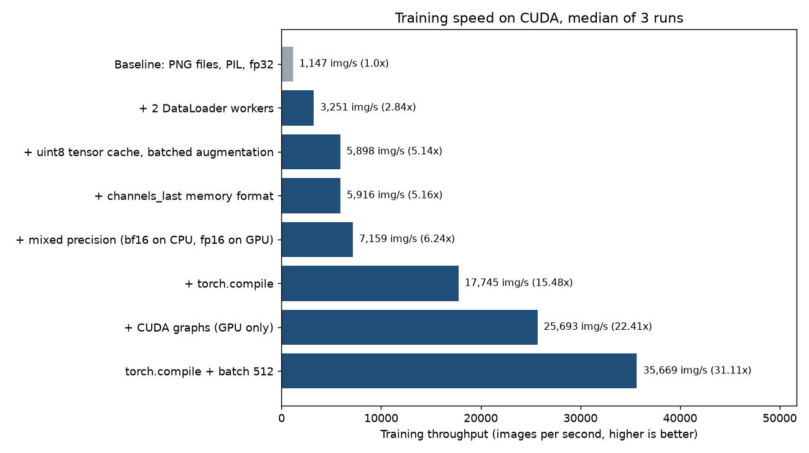
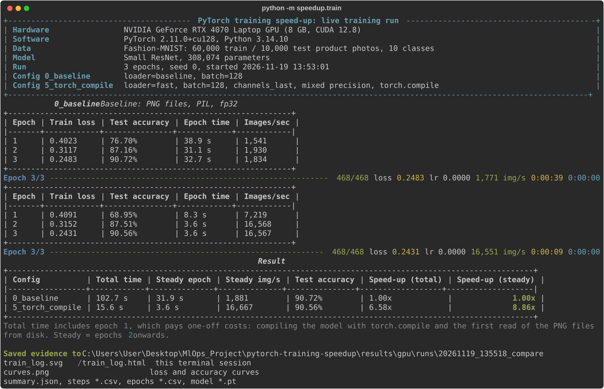

# Profiling and Speeding Up PyTorch Training

**15x faster on GPU and 3.5x faster on CPU, with no loss of accuracy. Every gain is measured and explained.**

[](https://github.com/akinpelumiajayi/pytorch-training-speedup/actions/workflows/ci.yml)


[](LICENSE)

I profiled an image classifier training on Fashion-MNIST, found what was slowing each step down on two kinds of hardware, and fixed it one measured change at a time. Test accuracy stayed level throughout.

## Key results

| Hardware | Baseline (3 epochs) | Optimised (3 epochs) | Speed-up | Test accuracy (before → after) |
|---|---:|---:|---:|---:|
| NVIDIA RTX 4070 Laptop GPU | 176.4 s | **11.7 s** | **15x** | 90.62% → 90.34% |
| 2-core Intel Xeon CPU | 452 s | **130 s** | **3.5x** | 90.63% → 90.40% |

The best GPU setup at the same batch size adds CUDA graphs and raises throughput from **1,147 to 25,693 images/sec (22x)**.



## What I did

- **Profiled before optimising.** I wrapped each stage of the training step (data loading, forward pass, backward pass, optimizer step) in `torch.profiler` and read the operator tables to find the real bottleneck.
- **Found that the bottleneck depends on the hardware.** On the CPU, the backward convolution took most of each step. On the GPU, **90% of each step went to loading PNG files** while the GPU sat idle.
- **Built a faster data pipeline.** A custom loader decodes the dataset once into a 47 MB `uint8` tensor and runs augmentation on whole batches with vectorised indexing. This cut data loading from 64% of the GPU step to 6%.
- **Applied compute optimisations as a controlled ablation.** I added `channels_last`, mixed precision (bfloat16 on CPU, float16 with `GradScaler` on GPU), `torch.compile` and CUDA graphs one at a time. Each one is benchmarked as the median of 3 runs, including the change that made things slower.
- **Checked that the model still learns.** The baseline and the optimised setup both train for full epochs from the same seed, and test accuracy is compared.
- **Engineered it like production code.** It is an installable package with pinned dependencies and a pytest suite. GitHub Actions runs it on Ubuntu and Windows. Every training run saves its logs, metrics, curves and weights.

**Skills shown:** PyTorch performance engineering · `torch.profiler` · mixed precision (bf16 / fp16) · `torch.compile` and CUDA graphs · data pipeline design · reproducible benchmarking · testing and CI/CD

## Live training dashboard

`python -m speedup.train --compare` trains the baseline and then the optimised setup, with a live terminal dashboard. This capture is from a real run on the RTX 4070:



```bash
python -m speedup.train                          # optimised setup, 3 epochs
python -m speedup.train --compare                # baseline, then optimised, with the speed-up
python -m speedup.train --config 0_baseline --epochs 5 --seed 1
python -m speedup.train --list                   # every config name
```

Every run saves its evidence to `results/<cpu|gpu>/runs/<date>_<time>_<name>/`:

| File | Contents |
|---|---|
| `train_log.svg`, `train_log.html` | The terminal output of the run |
| `curves.png` | Training loss per step, and test accuracy against training time |
| `summary.json` | Hardware, versions, seed, training time, images/sec, test accuracy |
| `steps_*.csv`, `epochs_*.csv` | Every logged step and epoch |
| `model_*.pt` | The trained weights (not committed to git) |

## Quick start

Requires Python 3.12+. Install the PyTorch build for your hardware first (CPU or CUDA), then the rest:

```bash
git clone https://github.com/akinpelumiajayi/pytorch-training-speedup.git
cd pytorch-training-speedup
python -m venv .venv
source .venv/bin/activate          # Windows: .venv\Scripts\activate

# pick one
pip install torch==2.11.0 torchvision==0.26.0 --index-url https://download.pytorch.org/whl/cpu
pip install torch==2.11.0 torchvision==0.26.0 --index-url https://download.pytorch.org/whl/cu128

pip install -r requirements.txt
pip install -e .
pip install "triton-windows<3.8"   # Windows + NVIDIA GPU only: needed by torch.compile

python -m speedup.data         # download Fashion-MNIST, export 70,000 PNGs, build the tensor cache
python -m speedup.profile      # profile the baseline and the optimised setup
python -m speedup.benchmark    # timing table, chart and accuracy check
python -m speedup.train        # train with a live dashboard
python -m speedup.show         # preview dataset images in the terminal (--class, --random, --augment)
pytest -q                      # 6 tests
```

Results go to `results/cpu/` or `results/gpu/` depending on the device, so runs on different hardware never overwrite each other. The profiler also writes Chrome traces to `results/<cpu|gpu>/trace_*.json`, which you can open in [Perfetto](https://ui.perfetto.dev) to see every operator on a timeline.

---

## Deep dive

### Setup

- **Data:** [Fashion-MNIST](https://github.com/zalandoresearch/fashion-mnist), 70,000 greyscale photos of Zalando catalogue products in 10 classes. The raw files are exported as one PNG per image in class folders, the layout most real image projects start from.
- **Model:** a small ResNet (3 residual blocks, 308,000 parameters) trained with SGD, Nesterov momentum and a one-cycle learning rate.
- **Augmentation:** random crop with 2-pixel padding and a random horizontal flip.
- **Baseline:** the standard tutorial setup. `torchvision.datasets.ImageFolder` reads PNG files, PIL transforms each image one at a time, all maths is float32, and the batch size is 128.
- **Hardware:**
  - GPU: NVIDIA RTX 4070 Laptop (8 GB), 16 CPU threads, PyTorch 2.11 with CUDA 12.8, Python 3.14.
  - CPU: 2-core Intel Xeon with AMX and AVX-512 bfloat16, PyTorch 2.14.1, Python 3.11.

### GPU results (RTX 4070 Laptop)

Each row adds one change to the row above. Throughput is the median of 3 runs.

| Change | Images/sec | ms/step | Speed-up | Data share |
|---|---:|---:|---:|---:|
| Baseline: PNG files, PIL, float32 | 1,147 | 111.6 | 1.00x | 67.1% |
| + 2 DataLoader workers | 3,251 | 39.4 | 2.84x | 64.0% |
| + uint8 tensor cache, batched augmentation | 5,898 | 21.7 | 5.14x | 6.0% |
| + channels_last memory format | 5,917 | 21.6 | 5.16x | 5.7% |
| + float16 mixed precision | 7,159 | 17.9 | 6.24x | 5.5% |
| **+ torch.compile** | **17,745** | **7.2** | **15.48x** | 12.7% |
| + CUDA graphs (GPU only) | 25,693 | 5.0 | 22.41x | 18.2% |
| torch.compile + batch 512 | 35,669 | 14.4 | 31.11x | 6.3% |

Full table with forward, backward and optimizer shares: [`results/gpu/benchmark.md`](results/gpu/benchmark.md).

**Data loading is the bottleneck.** The GPU does the maths so quickly that the profiler shows the baseline spending **90% of each step loading PNGs** ([`profile_0_baseline.txt`](results/gpu/profile_0_baseline.txt)). Worker processes gave 2.84x, and the tensor-cache loader then cut data loading from 64% to 6% of the step.

**torch.compile matters more than mixed precision.** float16 gave only 1.2x, because this small model's kernels are too short to keep the Tensor Cores busy. Most of the time was lost launching hundreds of tiny kernels. `torch.compile` fuses them (2.5x), and CUDA graphs (`torch.compile(mode="reduce-overhead")`) replay the whole step with a single launch (another 1.45x).

**A bigger batch is faster on the GPU.** Batch 512 is the fastest setup (31x), because each launch gives the GPU more work. I have not checked its accuracy yet. A larger batch usually needs its learning rate retuned, so the accuracy check uses batch 128.

**Accuracy** after 3 full epochs from the same seed ([`results/gpu/accuracy.json`](results/gpu/accuracy.json)):

| Setup | Seconds per epoch | 3-epoch training time | Test accuracy |
|---|---|---:|---:|
| Baseline | 111.6, 32.9, 32.0 | 176.4 s | 90.62% |
| Optimised (torch.compile, batch 128) | 4.1, 3.8, 3.8 | 11.7 s | 90.34% |

Part of the 15x comes from the baseline's slow first epoch, when the operating system first reads the 60,000 PNG files from disk. Once the files are cached, the gain is **8.4x per epoch** (32.0 s down to 3.8 s).

### CPU results (2-core Xeon)

**Profile of the baseline** ([`profile_0_baseline.txt`](results/cpu/profile_0_baseline.txt)):

| Stage | Time per step | Share |
|---|---:|---:|
| Data loading | 45.4 ms | 13.4% |
| Forward pass | 101.6 ms | 29.9% |
| **Backward pass** | **190.9 ms** | **56.3%** |
| Optimizer step | 1.5 ms | 0.4% |

The top operator is `aten::convolution_backward`, at **40% of all CPU time**, followed by the forward convolution at 18%. That pointed to making the convolution maths cheaper first, with the data pipeline second.

| Change | Images/sec | ms/step | Speed-up | Data share |
|---|---:|---:|---:|---:|
| Baseline: PNG files, PIL, float32 | 392 | 326 | 1.00x | 11.0% |
| + 2 DataLoader workers | 400 | 320 | 1.02x | 0.9% |
| + uint8 tensor cache, batched augmentation | 489 | 262 | 1.25x | 0.5% |
| + channels_last memory format | 500 | 256 | 1.27x | 0.5% |
| **+ bfloat16 mixed precision** | **1,210** | **106** | **3.09x** | 1.1% |
| **+ torch.compile** | **1,512** | **85** | **3.86x** | 1.4% |
| + batch 512 (slower, not kept) | 1,083 | 473 | 2.76x | 2.2% |


**What each change did:**

- **DataLoader workers (1.02x).** The workers hid the data loading time, but with only 2 cores they took CPU time away from the convolutions, so the overall gain was close to zero.
- **Tensor-cache loader (1.25x).** [`loaders.py`](src/speedup/loaders.py) turns each batch into a single tensor slice and runs the crop and flip with [`batch_augment`](src/speedup/loaders.py), instead of 128 separate PIL calls. This freed both cores for the model.
- **channels_last (1.02x).** Stores images in NHWC order, the layout oneDNN convolution kernels prefer. It gives a small gain on its own and prepares for the next step.
- **bfloat16 mixed precision (2.4x on top).** This was the biggest win, and it targets the convolution bottleneck directly. The CPU's AMX units process bfloat16 far faster than float32. bfloat16 has the same exponent range as float32, so no gradient scaling is needed.
- **torch.compile (1.25x on top).** Fuses the batch norm, ReLU and residual additions into fewer kernels, which cuts memory traffic. The benchmark runs warm-up steps first, so the one-off compile time is not counted.
- **Batch 512 (28% slower, not kept).** On 2 cores the larger activations no longer fit in cache, so this is the opposite of the GPU result.

**Accuracy** after 3 full epochs from the same seed ([`results/cpu/accuracy.json`](results/cpu/accuracy.json)):

| Setup | Seconds per epoch | 3-epoch training time | Test accuracy |
|---|---:|---:|---:|
| Baseline | 150.8 | 452 s | 90.63% |
| Optimised | 43.4 | 130 s | 90.40% |

### Notes on method

- Each accuracy figure comes from a single run, so expect the exact numbers to vary a little between runs.
- On the GPU, each profiled stage ends with a CUDA sync, so stage times include the GPU work and not only the launch time. These syncs break up CUDA graphs, so [`profile_5b_cuda_graphs.txt`](results/gpu/profile_5b_cuda_graphs.txt) understates that config. Use the benchmark table for its speed.
- Your numbers will differ on other hardware. A CPU without bfloat16 support gains less from mixed precision, and a faster GPU makes the data pipeline matter even more.

## Project structure

```
src/speedup/
├── data.py        download, PNG export, uint8 tensor cache
├── loaders.py     baseline ImageFolder loader and the fast TensorBatchLoader
├── model.py       small ResNet
├── train.py       training step with switchable speed-ups, timed benchmark, full training
├── live.py        live terminal dashboard for python -m speedup.train
├── show.py        preview dataset images in the terminal
├── profile.py     torch.profiler stage breakdown and operator tables
└── benchmark.py   ablation table, chart and accuracy check
results/cpu/       measured outputs from the CPU run
results/gpu/       measured outputs from the GPU run
tests/             pytest suite, run by GitHub Actions on Ubuntu and Windows
```

## Author

**Akinpelumi Michael Ajayi**, MSc Artificial Intelligence (Distinction)
[LinkedIn](https://www.linkedin.com/in/akinpelumi-michael-ajayi-) | [GitHub](https://github.com/akinpelumiajayi)

## Licence

MIT. Fashion-MNIST is released by Zalando Research under the MIT licence.
