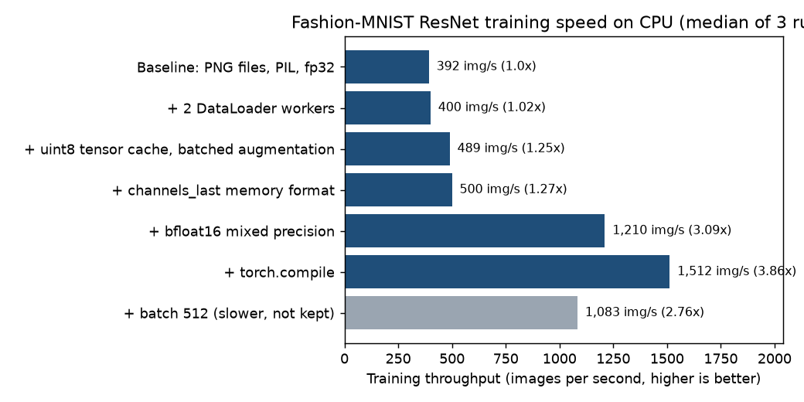

# Profiling and Speeding Up PyTorch Training: 3.5x Faster, Same Accuracy

I profiled a PyTorch image classifier training on real Zalando product photos, found where the time went, and cut a 3-epoch training run from **452 seconds to 130 seconds** (3.5x faster). Test accuracy stayed level: **90.6% before, 90.4% after**.

Every change is measured on its own, so you can see which ones paid off and which did not.



## The task

- **Data:** [Fashion-MNIST](https://github.com/zalandoresearch/fashion-mnist), 70,000 greyscale photos of Zalando catalogue products (t-shirts, trousers, bags, sneakers and 6 more classes). The raw files are exported as one PNG per image in class folders, the layout most real image projects start from.
- **Model:** a small ResNet (3 residual blocks, 308,000 parameters) trained with SGD, Nesterov momentum and a one-cycle learning rate.
- **Augmentation:** random crop with 2-pixel padding and a random horizontal flip.
- **Hardware:** 2-core Intel Xeon CPU with AMX and AVX-512 bfloat16 support, PyTorch 2.14.1, Python 3.11, no GPU. The code switches to float16 mixed precision automatically on a CUDA GPU (see [the GPU results](#gpu-results-rtx-4070-laptop)).

## Step 1: profile the baseline

The baseline is the standard tutorial setup: `torchvision.datasets.ImageFolder` reading PNG files, PIL transforms one image at a time, float32 maths, batch size 128.

`python -m speedup.profile` wraps each stage of the training step in `torch.profiler.record_function`:

| Stage | Time per step | Share |
|---|---:|---:|
| Data loading | 45.4 ms | 13.4% |
| Forward pass | 101.6 ms | 29.9% |
| **Backward pass** | **190.9 ms** | **56.3%** |
| Optimizer step | 1.5 ms | 0.4% |

The slowest step is the backward pass. The top operator is `aten::convolution_backward` at **40% of all CPU time**, with the forward convolution (`aten::mkldnn_convolution`) next at 18%. Data loading takes 13%, enough to matter but not the main cost. So the biggest win had to come from making the convolution maths cheaper, with a faster data pipeline second.

Full operator tables: [`results/cpu/profile_0_baseline.txt`](results/cpu/profile_0_baseline.txt) and [`results/cpu/profile_5_torch_compile.txt`](results/cpu/profile_5_torch_compile.txt).

## Step 2: apply one change at a time

Each row adds one change on top of the row above. Throughput is the median of 3 runs.

| Change | Images/sec | ms/step | Speed-up | Data share |
|---|---:|---:|---:|---:|
| Baseline: PNG files, PIL, float32 | 392 | 326 | 1.00x | 11.0% |
| + 2 DataLoader workers | 400 | 320 | 1.02x | 0.9% |
| + uint8 tensor cache, batched augmentation | 489 | 262 | 1.25x | 0.5% |
| + channels_last memory format | 500 | 256 | 1.27x | 0.5% |
| **+ bfloat16 mixed precision** | **1,210** | **106** | **3.09x** | 1.1% |
| **+ torch.compile** | **1,512** | **85** | **3.86x** | 1.4% |
| + batch 512 (slower, not kept) | 1,083 | 473 | 2.76x | 2.2% |

Full table with forward, backward and optimizer shares: [`results/cpu/benchmark.md`](results/cpu/benchmark.md).

### What each change does, and why it helped or did not

**DataLoader workers (1.02x).** Two worker processes hid the data loading time (11% down to 0.9%), but the machine has only 2 cores. The workers took CPU away from the convolutions, so the overall gain was close to zero.

**Custom tensor-cache loader (1.25x).** [`loaders.py`](src/speedup/loaders.py) decodes all 60,000 PNGs once into a single 47 MB `uint8` tensor. Each batch becomes one tensor slice, and the crop and flip run on the whole batch with vectorised indexing in [`batch_augment`](src/speedup/loaders.py) instead of 128 separate PIL calls. Data loading fell to 0.5% of step time and freed both cores for the model.

**channels_last (1.02x).** Stores images as NHWC, the layout oneDNN convolution kernels prefer. A small gain on its own, and it sets up the next step.

**bfloat16 mixed precision (2.4x on top).** The biggest win, aimed straight at the convolution bottleneck. `torch.autocast` runs convolutions in bfloat16, which this CPU's AMX units process far faster than float32. bfloat16 keeps float32's exponent range, so no gradient scaling is needed. On a CUDA GPU the same code uses float16 with `GradScaler`.

**torch.compile (1.25x on top).** Fuses the batch norm, ReLU and residual additions into fewer kernels, cutting memory traffic between operations. The first steps pay a one-off compile cost (under a minute here), which is why the benchmark warms up before timing.

**Batch 512 (slower, not kept).** Larger batches often help on a GPU. On a 2-core CPU, the bigger activations no longer fit in cache and throughput dropped by 28%. The final setup keeps batch 128.

## Step 3: check accuracy did not suffer

Speed means nothing if the model learns worse. Both setups trained for 3 full epochs from the same seed (`results/cpu/accuracy.json`):

| Setup | Seconds per epoch | 3-epoch training time | Test accuracy |
|---|---:|---:|---:|
| Baseline | 150.8 | 452 s | 90.63% |
| Optimised | 43.4 | 130 s | 90.40% |

The 0.23-point gap is small. Each setup ran once, so expect the exact figures to move a little between runs.

## GPU results (RTX 4070 Laptop)

The same benchmark on an NVIDIA GeForce RTX 4070 Laptop GPU (8 GB, PyTorch 2.11 with CUDA 12.8, 16 CPU threads). The results are in their own folder, [`results/gpu/`](results/gpu/).


| Change | Images/sec | ms/step | Speed-up | Data share |
|---|---:|---:|---:|---:|
| Baseline: PNG files, PIL, float32 | 1,147 | 111.6 | 1.00x | 67.1% |
| + 2 DataLoader workers | 3,251 | 39.4 | 2.84x | 64.0% |
| + uint8 tensor cache, batched augmentation | 5,898 | 21.7 | 5.14x | 6.0% |
| + channels_last memory format | 5,917 | 21.6 | 5.16x | 5.7% |
| + float16 mixed precision | 7,159 | 17.9 | 6.24x | 5.5% |
| **+ torch.compile** | **17,745** | **7.2** | **15.48x** | 12.7% |
| + CUDA graphs (GPU only) | 25,693 | 5.0 | 22.41x | 18.2% |
| torch.compile + batch 512 | 35,669 | 14.4 | 31.11x | 6.3% |

Full table: [`results/gpu/benchmark.md`](results/gpu/benchmark.md).

### What changes on a GPU

**The bottleneck moves to data loading.** On the CPU the convolutions took most of each step and data loading 13%. On the GPU the maths is fast, so the baseline spends **87% of each step loading PNGs** ([`profile_0_baseline.txt`](results/gpu/profile_0_baseline.txt)). The GPU sits idle most of the time.

**The data fixes matter far more.** Worker processes gave 1.02x on the 2-core CPU but 2.84x here, with 16 CPU threads to spare. The tensor-cache loader brought data loading down from 64% to 6% of the step.

**Mixed precision helps less, and torch.compile more.** float16 gave only 1.2x, because this small model's kernels are too short to keep the GPU's Tensor Cores busy. Each step instead loses time launching hundreds of tiny kernels. `torch.compile` fuses them (2.5x), and CUDA graphs (`torch.compile(mode="reduce-overhead")`) replay the whole step with one launch (another 1.45x).

**Batch 512 now wins.** It was 28% slower on the CPU but is the fastest setup here (31x), because a bigger batch gives the GPU more work per launch. Its accuracy has not been checked. A larger batch usually needs its learning rate retuned, so the accuracy check below keeps batch 128.

### Accuracy on the GPU

Both setups trained for 3 full epochs from the same seed ([`results/gpu/accuracy.json`](results/gpu/accuracy.json)):

| Setup | Seconds per epoch | 3-epoch training time | Test accuracy |
|---|---|---:|---:|
| Baseline | 111.6, 32.9, 32.0 | 176.4 s | 90.62% |
| Optimised (torch.compile, batch 128) | 4.1, 3.8, 3.8 | 11.7 s | 90.34% |

That is **15x faster end to end** with accuracy level. Part of that comes from the baseline's slow first epoch, where the operating system first reads the 60,000 PNG files from disk. Once those files are cached, the gain is **8.4x per epoch** (32.0 s down to 3.8 s).

Each stage of the GPU profile ends with a CUDA sync, so stage times include GPU work rather than just launch time. Those syncs break up CUDA graphs, so [`profile_5b_cuda_graphs.txt`](results/gpu/profile_5b_cuda_graphs.txt) understates that config. Use the benchmark table for its speed.

## Watch training live

`python -m speedup.train` trains with a live dashboard in the terminal. It shows the hardware and config, a progress bar with the current loss, learning rate and images/sec, and a table that gains a row per epoch with the test accuracy.

```bash
python -m speedup.train                          # optimised setup, 3 epochs
python -m speedup.train --compare                # baseline, then optimised, with the speed-up
python -m speedup.train --config 0_baseline --epochs 5 --seed 1
python -m speedup.train --list                   # every config name
```

Every run saves its evidence to `results/<cpu|gpu>/runs/<date>_<time>_<name>/`:

| File | Contents |
|---|---|
| `train_log.svg`, `train_log.html` | The terminal output of the run, saved automatically |
| `curves.png` | Training loss per step, and test accuracy against training time |
| `summary.json` | Hardware, versions, seed, training time, images/sec, test accuracy |
| `steps_*.csv`, `epochs_*.csv` | Every logged step and epoch |
| `model_*.pt` | The trained weights (not committed to git) |

## Run

Requires Python 3.12+. Install the PyTorch build for your hardware first (CPU or CUDA), then the rest:

```bash
git clone https://github.com/akinpelumiajayi/pytorch-training-speedup.git
cd pytorch-training-speedup
python -m venv .venv
source .venv/bin/activate          # Windows: .venv\Scripts\activate

# pick one
pip install torch==2.11.0 torchvision==0.26.0 --index-url https://download.pytorch.org/whl/cpu
pip install torch==2.11.0 torchvision==0.26.0 --index-url https://download.pytorch.org/whl/cu128

pip install -r requirements.txt
pip install -e .
pip install "triton-windows<3.8"   # Windows + NVIDIA GPU only: needed by torch.compile

python -m speedup.data         # download Fashion-MNIST, export 70,000 PNGs, build the tensor cache
python -m speedup.profile      # profile the baseline and the optimised setup
python -m speedup.benchmark    # timing table, chart and accuracy check
python -m speedup.train        # train with a live dashboard (see above)
python -m speedup.show         # preview dataset images in the terminal (--class, --random, --augment)
pytest -q                      # 6 tests
```

Results go to `results/cpu/` or `results/gpu/` depending on the device, so runs on different hardware never overwrite each other. The CPU benchmark takes about 15 minutes on 2 cores.

The profiler also writes Chrome traces to `results/<cpu|gpu>/trace_*.json`. Open them in [Perfetto](https://ui.perfetto.dev) to see every operator on a timeline.

## Note

Your numbers will differ with your hardware. A CPU without bfloat16 support gains less from mixed precision. A GPU shifts the bottleneck towards data loading, where the tensor-cache loader matters more (see the GPU results above).

## Project structure

```
src/speedup/
├── data.py        download, PNG export, uint8 tensor cache
├── loaders.py     baseline ImageFolder loader and the fast TensorBatchLoader
├── model.py       small ResNet
├── train.py       training step with switchable speed-ups, timed benchmark, full training
├── live.py        live terminal dashboard for python -m speedup.train
├── show.py        preview dataset images in the terminal
├── profile.py     torch.profiler stage breakdown and operator tables
└── benchmark.py   ablation table, chart and accuracy check
results/cpu/       measured outputs from the CPU run
results/gpu/       measured outputs from the GPU run
tests/             pytest suite, run by GitHub Actions on every push
```

## Author

Akinpelumi Michael Ajayi, MSc Artificial Intelligence (Distinction)
[LinkedIn](https://www.linkedin.com/in/akinpelumi-michael-ajayi-) | [GitHub](https://github.com/akinpelumiajayi)

## Licence

MIT. Fashion-MNIST is released by Zalando Research under the MIT licence.
